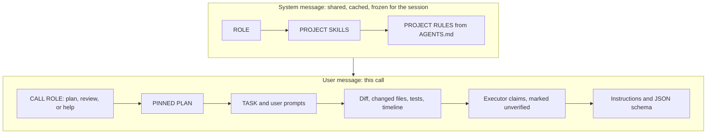

# Baton

Baton is an extension for the [pi](https://github.com/earendil-works/pi-coding-agent) coding agent, plus a pi-independent library and two CLIs (`baton-pack`, `baton-review`). It keeps an expensive model on decisions and review, and hands exploration and mechanical steps to cheaper machinery.

Two modes:

- **Advisor mode** builds one tool-less pack (diff, changed files, tests, project skills, pinned plan, unverified claims) and asks the advisor for a plan, a review, or help.
- **Switch mode** stays in one pi session and alternates a lead model with a cheap helper. **Speculative execution** lets the helper continue the lead's tool calls for a few steps, then returns a summary. It is off unless you enable it.

## Quick start

Requires Node.js 22 or newer. The extension and the CLIs run the compiled `dist/` output.

```sh
bun install
bun run build
```

Advisor mode, from this checkout:

```sh
pi -e ./dist/pi/index.js
# or, after the build: pi install .
```

The npm package name `pi-baton` is not final and is not published yet. Until release, install from this checkout as above. After release: `pi install npm:pi-baton`.

Switch mode needs `OPENROUTER_API_KEY` (Jev, lead-cache keepalive, and OpenRouter models):

```sh
export OPENROUTER_API_KEY=...
BATON_MODE=switch pi -e ./dist/pi/index.js
# speculative execution:
BATON_SPEC=1 pi -e ./dist/pi/switch.js
```

`./dist/pi/switch.js` is always switch mode. `./dist/pi/index.js` is advisor mode unless `BATON_MODE=switch`.

Print a pack with no model call: `node bin/baton-pack.mjs --help`.

## Advisor mode

The executor (the pi session) calls `baton_plan`, `baton_review`, or `baton_help`. Baton collects git state, the journal, project skills, and `AGENTS.md`, then makes one advisor call. The advisor has no tools. Executor claims are labelled unverified; the diff and the test output are the evidence. Run the tests before a review.



The system message is the same text for plan, review, and help, so a later call can hit the prompt cache. Skills and `AGENTS.md` are chosen on the first advisor call and then kept for the whole session. A skill you add after that call is not picked up until a new session. The kind-specific instructions are the `CALL ROLE` section at the start of the user message.

A conservative token estimate (characters / 2.4, non-ASCII characters counted twice) drops the most cuttable sections first: repo map and changed files, then skills, plan, and timeline, then the diff, then test output. The task, claims, and instructions stay.

The reply is validated JSON. On invalid or cut-off JSON, Baton retries once. Verdicts: `on_track`, `course_correct`, `replan`, `done`, `need_user`. `need_user` means the task is ambiguous or needs a decision from the user; the questions are in `questions_for_user`. Plan steps carry `done_when` and `verify`: `self` (the executor checks it, no re-review) or `review`.

| Tool | What it does |
|---|---|
| `baton_plan` | Skills, `AGENTS.md`, repo map, exploration notes → a plan with invariants, skill rules, and checkpoints. Pinned into later requests. |
| `baton_review` | Diff, changed files, last test, pinned plan, unverified claims → verdict and fixes. Required before `git commit` when review-before-commit is on. |
| `baton_help` | Last N tool calls verbatim (default 8), same-error calls, hypothesis and attempts → cause and a plan. |
| `baton_step` | Mark a pinned step `done`, `in_progress`, `blocked`, or `deferred`, with evidence. No advisor call. |
| `baton_recall` | Full output of a journal event (`evt`). |

Review gating refuses `baton_review` until the previous review's `verify: review` steps are closed, or about 15 tool calls or 80 changed lines have accumulated. `baton_help` is refused for 5 tool calls after an advisor reply. After verdict `done`, finalize mode blocks further edits until you commit (checks and `git add` / `git commit` still pass). The first write without a plan is blocked once. `/baton` shows status; `/baton reset` compacts when compaction is on; `/baton unblock` and `/baton drop` rule on deferred loop items.

The loop detector (on by default) forces `baton_help` when the same failure keeps looping. The item is deferred and edits to its test file stay blocked until a review or `/baton unblock` clears it.

Compaction is off by default (`compact.enabled`). The advisor reply is appended and pi's own auto-compaction is left alone. With compaction on, each handoff resets the executor context to the task, the pinned plan, the advisor reply, and the last calls; older outputs become `evt` stubs.

Every tool call is journaled for the pi session at `<journalDir>/sessions/<session id>/events.jsonl`, with raw output in `raw/` beside it (default journal dir `.pi/baton`). `pi -c` reloads that session's journal, including pinned-plan progress, the review gate, and deferred items. A new session starts clean. If pi has no session id, events fall back to `<journalDir>/events.jsonl`. The journal directory receives a `.gitignore` containing `*` when that file is absent.

While a pinned plan is open and the verdict is not `done`, advisor keepalive pings the cached system prefix (default every 240000 ms, at most 5 times). It runs only when `advisor.cache` is `"short"`, and it stops after `done`.

## Switch mode

One pi session. The lead model plans and writes; the helper reads, implements from a spec, runs verify/fix loops, and can do a final review. You see one conversation. The lead does not see the helper's raw turns: it gets a `[Baton harness]` report (read outputs, or a short interruption summary with files, definitions, and check status). Skill files the helper reads are passed through in full.


Defaults: lead `openrouter/anthropic/claude-opus-5.5`, helper `openrouter/z-ai/glm-5.3-flash`. Override with `BATON_LEAD` and `BATON_HELPER`.

Lead-only tools: `baton_read` (study code; default on, 8 calls per session), `baton_edit` (helper applies a change and Baton runs checks; default on, 12 calls), `baton_delegate` (`reads`, `implement`, or `debug`), `delegate_reads`, `baton_optimize`. `BATON_EDIT=intent` keeps edit intents and turns the edit tool off. `BATON_EDIT=off` and `BATON_READ=0` turn those tools off.

Helper guardrails block `--passWithNoTests`, new ``as unknown as`` casts, package version downgrades, and skipped or deleted tests. They run before the Jev supervisor. Jev (`typesafe/jev-1.13`, fallback `microsoft/microsoft-decision-1`, 800 ms per attempt) scores helper tool calls and lead/debug/review turn boundaries. If Jev errors, the deterministic rules still apply. `BATON_JEV=0` turns Jev off. Thresholds and the rest of the Jev config: `DEFAULT_JEV` in `src/pi/jev-config.ts`.

Resume a pi session on the lead with `BATON_SWITCH_START=lead` and `pi -c`. Spend counters belong to the process, so set `BATON_BUDGET_USD` again to the cap you still want.

### Speculative execution

Set `BATON_SPEC=1` (or `switch.spec.enabled`). The helper continues the lead's own tool sequence for a short run, then the lead resumes. The file-system guard, the helper guardrails, and the per-call Jev gate stay off for that session. Jev is still asked how likely more tool calls are. After a lead turn that used tools:

- At least 0.93 (`thrHigh`): the helper continues for 8 steps (`nHigh`).
- At least 0.80 and below 0.93 (`thr`): 4 steps (`nLow`).
- Below 0.80: the lead continues, and nothing is delegated.

No run exceeds 10 steps (`maxSteps`). One lead turn is left alone between runs (`cooldown`). The helper stops early when it stops calling tools. The lead then receives a harness summary: each call with ok or error, files written, `git diff --stat`, the last check, and the helper's last note. The helper's turns stay out of the lead's view.

Optional controls (each needs `BATON_SPEC=1`; `BATON_SPEC_V2=1` turns all five on):

| Flag | What changes the step count |
|---|---|
| `BATON_SPEC_GATE` | The first 3 steps run unchecked. Before each later step Jev estimates P(continue); below 0.70 the lead takes over. The run starts at `maxSteps` (10). An estimate or an adaptive ceiling can still shorten it. |
| `BATON_SPEC_STOPS` | The first tool error, or a repeated call (same tool and arguments, including the lead's last calls), returns control to the lead. A helper turn with no tool calls ends the run either way. |
| `BATON_SPEC_EST` | Jev also estimates remaining steps (10, 6, 3, or 2). That estimate caps the run. |
| `BATON_SPEC_PHASE` | Reads and test or build commands proceed. If the lead just edited files, the helper may edit only those. Any other edit is blocked and the lead takes over. |
| `BATON_SPEC_ADAPT` | After a run, if the lead edits a file the helper edited, repeats a helper call, or runs `git checkout` / `restore` / `stash` / `reset`, the next ceiling drops by 2 (floor 2). Otherwise it rises by 1 (ceiling 10). It starts at 6. |

### Budget

`BATON_BUDGET_USD` or `switch.budgetUsd` (default 0, off). Spend is the lead's reported cost, plus the helper's cost times `helperCostFactor` (2.3), plus Jev and lead-keepalive estimates. The session stops when that sum plus `reserveUsd` (0.25) reaches the budget. The total is cumulative for the pi process. After a stop, every later prompt in that process is aborted and a notice is shown. A non-numeric `BATON_BUDGET_USD` is ignored and a warning is shown.

When `budgetUsd − reserveUsd − current estimate` is below `endgameUsd` (0.30), automatic handoffs for routine reads and for a failing verify stay with the lead.

During an active agent run, while the helper holds the session and the lead provider is OpenRouter, Baton can replay the last lead request to keep the prompt cache warm (`cacheKeepaliveMs` 230000, at most `cacheKeepaliveMax` 5 pings per helper stretch). Each counted ping adds `cacheKeepaliveCostUsd` (0.06) to the budget.

### File-system guard

In phased switch mode, while the helper is reading (`read` and follow-up stretches), Baton snapshots the worktree around helper calls that can write. A revert runs only when both snapshots succeed and `HEAD` is unchanged. If a snapshot fails, the working tree is left as it is and the lead takes the turn. Path lists use `--literal-pathspecs`, so a name such as `app/[id].tsx` is matched as a literal path. Paths are relative to the git root.

Clean tracked files are restored from `HEAD` in the index and the worktree. Files that were already dirty go back to the pre-call snapshot, so earlier uncommitted edits remain. Files created after the snapshot are deleted. A directory path is left in place (empty parent directories of a removed new file may be removed). The guard skips symlinks. If more than `fsGuardMaxRevert` paths would change (default 50), or that cap is 0, or a gitignore or index change would expose ignored files, the guard leaves the tree and hands the turn to the lead. Package installs, `package.json`, lockfiles, `node_modules`, and a moved `HEAD` are reported and left in place. Build and test artefacts are ignored. A backup (copies and `changes.patch`) is written under `<journalDir>/fsguard/`.

Speculative runs leave the helper's writes in the worktree.

### Journal

Switch writes `<journalDir>/switch.jsonl` (switches, blocked calls, Jev decisions, usage) and `<journalDir>/switch-summary.json` (costs, metrics, Jev totals, speculative-run stats). The default directory is `.pi/baton`. Advisor session journals, when both modes have been used, live under `<journalDir>/sessions/`.

### Environment

On/off flags accept `1` / `on` / `true` / `yes` and `0` / `off` / `false` / `no`. Any other value is ignored.

| Variable | Role |
|---|---|
| `OPENROUTER_API_KEY` | Required for switch mode. Never read from config. |
| `BATON_MODE` | Set to `switch` to run switch mode from `dist/pi/index.js`. |
| `BATON_SPEC` | Turn speculative execution on or off. |
| `BATON_SPEC_V2` | Turn on all five speculative controls. `BATON_SPEC=1` is still required. |
| `BATON_SPEC_GATE` | Per-step continue check after the free steps. |
| `BATON_SPEC_STOPS` | Stop on error, repeat, or a text-only answer. |
| `BATON_SPEC_EST` | Cap the run with Jev's step estimate. |
| `BATON_SPEC_PHASE` | Hand the first out-of-plan edit back to the lead. |
| `BATON_SPEC_ADAPT` | Raise or lower the next run's ceiling from the lead's reaction. |
| `BATON_BUDGET_USD` | Positive process-wide budget in USD. |
| `BATON_JEV` | Jev supervisor on or off (default on). |
| `BATON_JEV_MODEL` | Decision model (default `typesafe/jev-1.13`). |
| `BATON_JEV_FALLBACK_MODEL` | Fallback decision model. |
| `BATON_EDIT` | `tool` (default), `intent`, or `off`. |
| `BATON_READ` | `baton_read` on or off (default on). |
| `BATON_SWITCH_START` | Set to `lead` to resume on the lead model. |
| `BATON_LEAD` | Lead model, `provider/id` in pi's registry. |
| `BATON_HELPER` | Helper model, same form. |
| `BATON_JOURNAL_DIR` | Journal directory. Must stay inside the working directory. |
| `PI_CODING_AGENT_DIR` | Overrides `~/.pi/agent` for the user config file. |

`BATON_MODE` must be the word `switch`. `BATON_SWITCH_START` must be the word `lead`. `BATON_EDIT=1` selects `tool`; `BATON_EDIT=0` selects `off`.

### Configuration

User file `~/.pi/agent/baton.json` (or `$PI_CODING_AGENT_DIR/baton.json`), then the project file `.pi/baton.json`. Switch settings live under `"switch"`.

Models, keepalive (`cacheKeepaliveMs`, `cacheKeepaliveCostUsd`, `cacheKeepaliveMax`), `budgetUsd`, `helperCostFactor`, `reserveUsd`, `endgameUsd`, `fsGuardMaxRevert`, `switch.jev.model`, `switch.jev.fallbackModel`, and `journalDir` are read only from the user file or the environment. The same keys in a project `.pi/baton.json` are ignored, with a warning, as are `switch.jev.endpoint`, `switch.jev.url`, and `switch.jev.baseUrl`. `journalDir` must resolve inside the working directory; otherwise Baton uses `.pi/baton`.

Every switch key and its default is `DEFAULT_SWITCH` in `src/pi/switch-core.ts`. Jev defaults are `DEFAULT_JEV` in `src/pi/jev-config.ts`. Caps you will see in config: `maxImplementCalls` 60, `maxEditTool` 12, `maxReadTool` 8, `maxLengthContinuations` 3, `cacheKeepaliveMax` 5, `fsGuardMaxRevert` 50.

### Safety notes

Phased switch mode can revert files the helper changed during a reading stretch. Backups are under `<journalDir>/fsguard/`. See [File-system guard](#file-system-guard) for when a revert is skipped. Speculative runs keep the helper's writes; check the harness summary before relying on them. A budget stop aborts later prompts in that process.

## Architecture

`src/core/` has no pi imports (Node and TypeBox only):

- `pack/sections.ts` — section order, budget fitting, the shared role, attribute escaping
- `pack/index.ts` — `buildReviewPack` → `{ messages, sections, tokens, stableTokens }`; `buildPack`
- `pack/collect.ts` — `collectPackInput`: git diff, changed files, last test, skills, `AGENTS.md`
- `advisor.ts` — `runAdvisor`: validation, one retry, `usages` for every attempt
- `openrouter.ts` — OpenRouter transport; `timeoutMs` default 300000
- `journal.ts` — per-session `events.jsonl` and `raw/`
- `repo.ts`, `skills.ts`, `schema.ts`, `util.ts`
- `jev.ts` — decisions API client; the package entry leaves it out

`src/cli/` — `baton-pack`, `baton-review` (compiled to `dist/cli`, launched from `bin/`).

`src/pi/` — the pi extension:

- `index.ts` — advisor tools and `/baton`; `BATON_MODE=switch` loads `switch.ts`
- `advisor.ts` — pi model-registry transport
- `gate.ts`, `triggers.ts` — review gating, finalize, plan and commit gates, nudges
- `loop.ts` — stuck-loop detector
- `mask.ts`, `reset.ts` — optional handoff compaction
- `config.ts` — `DEFAULT_CONFIG`
- `switch.ts` — session wiring: tools, budget, keepalive, journal
- `switch-core.ts` — `DEFAULT_SWITCH`, phase decisions, speculative execution
- `fsguard.ts` — worktree snapshots and revert
- `jev-config.ts` — `DEFAULT_JEV`
- `jev-policy.ts` — decision questions, thresholds, call summaries

`package.json` exports `pi-baton` and `pi-baton/core` to `dist/core`, and `pi-baton/pi` to `dist/pi/index.js`. `pi.extensions` is `./dist/pi/index.js`.

## Library API

```ts
import { collectPackInput, buildReviewPack, runAdvisor, openRouterComplete } from "pi-baton";

const input = await collectPackInput({
  kind: "review", // "review" | "help" | "plan"
  cwd: "/path/to/repo",
  task: "Add a pause button to the game",
  plan: pinnedPlanText, // optional contract to review against
  claims: ["all tests pass"], // shown as unverified
});
const pack = buildReviewPack(input, { budgetTokens: 40_000 });
// pack.messages = [{ role: "system", content, cache: true }, { role: "user", content }]

const res = await runAdvisor(
  "anthropic/claude-opus-5.5",
  pack.messages,
  openRouterComplete({ model: "anthropic/claude-opus-5.5", maxTokens: 8192, timeoutMs: 300_000 }),
);
if (res.ok && res.reply) console.log(res.reply.verdict, res.reply.plan);
// res.usage is the last attempt; res.usages is every attempt, including a retry
```

`collectPackInput` accepts `userPrompts`, `journal`, `hypothesis`, `attempts`, `importantEvts`, `excludePaths`, `skills`, and an injectable `exec`. You can also fill `PackInput` yourself and call `buildReviewPack`. Pass `frozenSystem` to reuse a previous system prefix. `runAdvisor` accepts any `complete(messages)` function. Attribute values in the pack are escaped, and `</file>`, `</skill>`, and `</baton_pack>` inside bodies are neutralised.

The decisions client lives in `src/core/jev.ts` and is left out of this export.

## CLI

Build first (`bun run build`). The `baton-pack` and `baton-review` binaries are Node launchers for `dist/cli`. Both accept `-h` / `--help` and `-V` / `--version`. An unknown flag is an error (exit 2). `--budget` and `--max-tokens` must be positive integers.

```sh
node bin/baton-pack.mjs --help
node bin/baton-pack.mjs --cwd ./my-repo "Add a pause button"
node bin/baton-pack.mjs --kind plan --json --task-file TASK.md
node bin/baton-pack.mjs --plan PLAN.md --claim "tests pass" "Add a pause button"

# OPENROUTER_API_KEY from the environment only
node bin/baton-review.mjs --help
node bin/baton-review.mjs --model anthropic/claude-opus-5.5 --cwd ./my-repo "Add a pause button"
node bin/baton-review.mjs --json --no-cache --max-tokens 4096 "Add a pause button"
```

Shared options: `--cwd DIR`, `--kind review|help|plan` (default `review`), `--plan FILE`, `--claim TEXT` (repeatable), `--task-file FILE`, `--budget N` (default 40000), `--json`. `baton-review` adds `--model` (default `anthropic/claude-opus-5.5`), `--max-tokens`, and `--no-cache`. `--json` on `baton-review` prints the validated reply. A failed advisor call exits 1.

## Configuration

Advisor mode reads `~/.pi/agent/baton.json`, then `.pi/baton.json` in the project (deep-merged). Keys whose names look like secrets (`apiKey`, `token`, `secret`, `password`) are ignored. Full defaults: [`baton.example.json`](baton.example.json), equal to `DEFAULT_CONFIG` in `src/pi/config.ts`.

| Group | Keys (defaults) |
|---|---|
| `advisor` | `model` (`openrouter/anthropic/claude-opus-5.5`), `maxTokens` 8192, `cache` `"short"` \| `"long"` \| `"none"`, `keepalive` `{ everyMs: 240000, max: 5 }` (`everyMs` 0 turns it off; pings run only for `"short"` and stop after `done`) |
| `pack` | `budgetTokens` 40000, `excludePaths` (journal, `node_modules`, `dist`, lockfiles), `skills` `{ enabled, budgetRatio: 0.35, maxSkills: 4, dirs }`, `pinPlan` true, `helpLastCalls` 8 |
| `review` | `enabled`, `minDiffLines` 80, `minCalls` 15, `helpMinCalls` 5, `finalizeAfterDone` |
| `triggers` | `contextRatio` 0.6, `sameErrorCount` 3, `reviewBeforeCommit`, `remindEvery` 12, `minGapCalls` 5, `milestoneReview`, `autoPlanAfterReads` 8, `planBeforeWrite`, `driftCalls` 20 |
| `loop` | `enabled`, `windowCalls` 30, `maxHops` 6, `hopGapCalls` 30, `readRepeatThreshold` 8, `action` `"help"` \| `"nudge"`, `blockDeferredEdits`, `ignoreReadPaths` |
| `compact` | `enabled` false, `keepTurns` 2, `keepCalls` 2, `exemptTools`, `neverMaskPaths`, `replaceAutoCompact` |
| — | `journalDir` `.pi/baton` |

In pi, the stable prefix is the system prompt and `advisor.cache` maps to pi's cache retention. The OpenRouter client in the CLI marks Anthropic models itself (`--no-cache` disables that).

Switch configuration is separate; see [Switch mode](#switch-mode).

## Privacy and data flow

Advisor packs send the task text, user prompts, the diff, changed file contents, test output, selected project skills, and `AGENTS.md` to the configured advisor provider. In the extension that is whatever provider pi's model registry resolves (`advisor.model`, default OpenRouter / Anthropic). The CLIs call OpenRouter.

Switch mode also sends the task text and short tails of recent tool output to OpenRouter's decisions endpoint (`https://openrouter.ai/api/alpha/decisions`) unless `BATON_JEV=0`. Speculative execution uses that endpoint to decide whether the helper should continue.

The journal stores raw tool outputs on disk under the journal directory. That directory is gitignored automatically (`*`) when it has no `.gitignore` yet. `pack.excludePaths` keeps matching paths out of packs (the journal directory, `node_modules`, `dist`, and lockfiles are already in the default list).

API keys come from the environment (`OPENROUTER_API_KEY`) or from pi's auth. They are not read from Baton's config files.

## Development

```sh
bun install
bun run check     # tsc --noEmit and vitest
bun run build     # tsc -p tsconfig.build.json → dist/
bun run smoke     # npm pack, install the tarball, run the bins
bun run coverage  # vitest --coverage
```

Tests fake the transports and assert the request shape.

GitHub Actions (`.github/workflows/ci.yml`) runs on push and pull request, on Node.js 22 and 24: `bun install --frozen-lockfile`, `bun run check`, `bun run build`, `bun run smoke`.

## License

MIT
