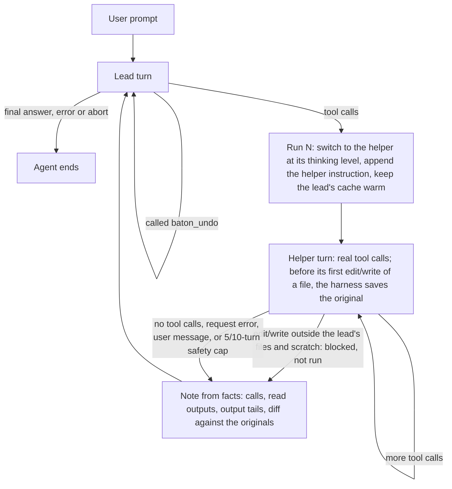

# Baton

Baton is an extension for the [pi](https://github.com/earendil-works/pi-coding-agent) coding agent that runs **speculative execution** inside one session. An expensive lead model (Opus by default) owns the task and writes the product. After each lead turn that ends with tool calls, a cheap helper model (GLM by default) takes the next steps the lead has already decided (reads, checks, fixes of what they report, scratch tests) in the same session, with the same context, until a step needs the lead. Then the lead takes over and gets a `[Baton]` note with the facts of the run. **The lead decides** what to do with it: keep it, fix it, or undo it.

The harness makes no decisions about quality: it does not run checks, does not judge the helper's commands, and has no heuristics about when speculation pays off. It hands over, enforces one fixed authorship boundary (the helper may change only files the lead has written, plus scratch files), records facts, and offers an undo.

## How it works



- **One session, two views.** The lead never sees helper turns or the helper instruction, only the notes appended at the end of its context, so its prompt cache stays valid. The helper sees the lead's view (with the lead's thinking extracted to text, and restored when switching back to the lead) plus its current run.
- **The lead writes the product.** The helper edits files and runs commands for real, so it can run checks and fix what they report, but only in files the lead has already written (see [What the helper may change](#what-the-helper-may-change)). New files, designs and APIs come from the lead. In the reatom-2048 eval, when the helper wrote whole features, the lead mostly kept them, and the hidden tests that still failed were in helper-written code.
- **Natural stop.** A run ends when the helper stops calling tools (the step is done or needs a decision), when it tries to change a file it may not change, when its request fails, when the user sends a message, or at a safety cap (10 turns, 5 on the first run). There is no time limit: while the helper works, Baton keeps the lead's prompt cache warm (see [Lead cache keepalive](#lead-cache-keepalive)).
- **No predictor.** A run starts after every lead turn with tool calls, except a turn that called `baton_undo`. A useless run costs one cheap request and a two-line note.

### What the lead reads after a run

```text
[Baton] Speculative run #3 by the helper model (glm-5.3-flash), not by you. Its file changes are already on disk.
It stopped because the helper ended its turn without tool calls: 4 turn(s), 7 tool call(s).

Tool calls:
1. read src/game/pieces.ts → ok (output below)
2. grep "clearRows" → ok (output below)
3. write .pi/baton/scratch/rows.test.ts → ok
4. bash `npx vitest run .pi/baton/scratch/rows.test.ts` → error
   FAIL .pi/baton/scratch/rows.test.ts > clears two full rows at once
   Tests: 1 failed, 3 passed
5. edit src/game/board.ts → ok
6. bash `npx vitest run .pi/baton/scratch/rows.test.ts` → ok
   Tests: 4 passed
7. bash `npx tsc --noEmit` → ok

Files changed with edit/write (undo: baton_undo({run: 3}) or baton_undo({run: 3, paths: [...]})):
- modified src/game/board.ts (+2 −1)
- created .pi/baton/scratch/rows.test.ts (+41 −0)
Bash commands above may also have changed files; such changes are not in this diff.

Diff (before the run → now):
...

Read outputs (verbatim):
--- read src/game/pieces.ts ---
...

Continue from here: keep the run, fix it, or undo it.
```

- Statuses come only from the tool's own error flag, except `blocked, not run` for calls the harness refused. Commands are shown with the tail of their output (2000 characters), so the lead judges a piped `npm test | tail` itself.
- Read outputs are passed verbatim and deduplicated, so the lead does not re-read the files.
- The helper's own text is never included: a claim like "all green" never reaches the lead.
- The note is capped at `noteChars`. Read outputs are omitted first (with a marker), then the diff is clipped per file.

### What the lead is told up front

A section appended to the system prompt says that the lead is the author of the work, what the helper may change, and how to use a run:

- **Hand off decided steps:** one sentence in a reply, such as "Helper: run the typecheck and the build, fix type errors" or "Helper: write a scratch test for … and run it". Without one, the helper takes only the steps the lead's messages and reasoning already commit to.
- **Review the diff as its own code** before building on it, then keep it, fix it with ordinary edits, or undo it with `baton_undo({run, paths?})`, which can be batched with other calls in the same turn. Nothing the note shows needs to be redone or re-read.
- **Verify before the final answer:** the harness runs no checks.

### What the helper may change

The helper may read anything and run any command. With `edit` and `write` it may change only:

- files the lead changed with `edit` or `write` earlier in the session, listed in the helper instruction of each run;
- files under `<journalDir>/scratch/` (`.pi/baton/scratch/` by default, ignored by git): scratch tests, scripts and logs.

Any other `edit` or `write` is blocked before it runs. The call shows as `blocked, not run` in the note, the run ends at once, and the note says which file the helper tried to change. This is a boundary of authorship, not a judgment of the change: the lead creates every product file and decides its design, after which the helper may make targeted edits to it. File changes made through `bash` cannot be blocked; the helper is told to change files only with `edit`/`write`, and the note lists every command.

During a run the helper thinks at `helperThinking` (`low` by default); the lead's level comes back when the lead takes over.

### Undo

Before the helper's first `edit` or `write` of a file in a run, the harness saves the file's content (or notes that it did not exist). The same originals produce the diff. `baton_undo` writes them back and deletes files the run created, but only for files that are still exactly as the run left them. Files changed after the run are left alone and listed. Changes made through `bash` are not covered; the helper is told to change files only with `edit`/`write`. No git is involved, so it works in any directory.

### Lead cache keepalive

Anthropic keeps a prompt cache entry for 5 minutes after the request that last used it. The lead sends nothing during a run, so after a long run its next turn would write its whole prompt to the cache again instead of reading it (a cache write costs 1.25× the input price, a read 0.1× or less). While a run is active, Baton re-sends the lead's last request every `cacheKeepaliveMs` (290 s), counted from the start of that request and then of each re-send:

- **The same request.** The body is the lead's last provider payload, copied when pi sent it. Messages, tools, thinking settings, `max_tokens` and cache markers stay as they were, because a change to any of them misses the cache. It goes through pi's own provider with the same session id, which OpenRouter uses to route to the same upstream cache.
- **Aborted at once.** The re-send is aborted at the first event of the model's reply. By then the provider has read the prompt and renewed the entry, so it costs a cache read and a few output tokens.
- **Only while the lead waits.** It starts with a run, if the lead's last request used the prompt cache, and stops when the run ends, a prompt arrives, the agent ends, or the session changes. A run that ends within 290 s of the lead's request sends nothing.
- **Outside the transcript.** Neither model sees it. Each re-send is a `cache_keepalive` journal event with the usage the provider reported before the abort, and that usage counts in `summary.json`. Anthropic's API reports usage at the start of a reply; OpenAI-compatible endpoints report it only at the end, so their events carry no usage. Pi's own session cost does not include these requests.

290 s leaves 10 s of the 5-minute lifetime for the request to reach the provider. The clock starts when pi hands the lead's request to the provider, slightly before the provider renews the entry. If an event shows `cacheWrite` instead of `cacheRead`, lower `cacheKeepaliveMs`. With `PI_CACHE_RETENTION=long` the entry lives an hour, so runs shorter than that need no keepalive: set `cacheKeepaliveMs` to `0`.

Pi's own `cacheWarming` cannot do this: it refreshes only the current request, which after the switch to the helper is the helper's. Pi's bundled catalog also gives the default OpenRouter Opus no cache lifetime, so pi does not warm it even between helper runs.

## Quick start

Requires Node.js 22 or newer, and `OPENROUTER_API_KEY` for the default models.

```sh
bun install
bun run build
export OPENROUTER_API_KEY=...
pi -e ./dist/index.js
# or, after the build: pi install .
```

The npm name `pi-baton` is not published yet. `BATON_SPEC=0` keeps the lead working alone, which is the baseline for comparing runs.

## Configuration

User file `~/.pi/agent/baton.json` (or `$PI_CODING_AGENT_DIR/baton.json`), then the project file `.pi/baton.json`, then environment variables. `lead`, `helper` and `journalDir` are ignored in the project file (with a warning): a repository cannot choose your models or file locations.

| Key | Default | Environment | Meaning |
|---|---|---|---|
| `lead` | `openrouter/anthropic/claude-opus-5.5` | `BATON_LEAD` | Lead model, `provider/id` in pi's registry |
| `helper` | `openrouter/z-ai/glm-5.3-flash` | `BATON_HELPER` | Helper model |
| `helperThinking` | `low` | `BATON_HELPER_THINKING` | Helper thinking level during a run: `off`, `minimal`, `low`, `medium`, `high`, `xhigh`, `max`, or `inherit` to keep the lead's level |
| `speculate` | `true` | `BATON_SPEC` | Speculative runs on or off; off when lead and helper are the same model |
| `maxHelperTurns` | `10` | `BATON_MAX_TURNS` | Safety cap of helper turns per run (`5` on the first run) |
| `noteChars` | `80000` | | Size cap of one note |
| `cacheKeepaliveMs` | `290000` | `BATON_CACHE_KEEPALIVE_MS` | [Lead cache keepalive](#lead-cache-keepalive) interval during a run; `0` = off, otherwise 60000–3600000 |
| `journalDir` | `.pi/baton` | `BATON_JOURNAL_DIR` | Must stay inside the working directory |

On/off variables accept `1`/`on`/`true`/`yes` and `0`/`off`/`false`/`no`.

## Journal

Per pi session: `<journalDir>/sessions/<session id>/events.jsonl` (prompts, run starts and ends, per-request usage including the lead's cache writes, lead cache keepalives, undos) and `summary.json` (costs per model including keepalives, run stats with blocked writes, stop reasons, every run with its changed and undone files and the file it was blocked on). The journal directory gets a `.gitignore` of `*`.

## Architecture

| File | Role |
|---|---|
| `src/extension.ts` | pi wiring: hand-over, thinking levels, the helper's write boundary, stop rules, notes, usage, `baton_undo` |
| `src/run.ts` | Run state, saved originals, changes, undo, which files the helper may change |
| `src/notes.ts` | Every text the models read: lead system section, helper instruction, run note, undo result |
| `src/context.ts` | Lead and helper views of the transcript |
| `src/keepalive.ts` | Lead cache keepalive: re-sends the lead's last request during a run |
| `src/config.ts` | Configuration |
| `src/journal.ts` | Journal |

## Development

```sh
bun install
bun run check     # tsc --noEmit and vitest
bun run build     # tsc -p tsconfig.build.json → dist/
bun run smoke     # npm pack, install the tarball, load the extension
```

GitHub Actions runs check, build and smoke on Node.js 22 and 24. The experiment log of earlier versions is in [docs/history.md](docs/history.md).

## License

MIT
