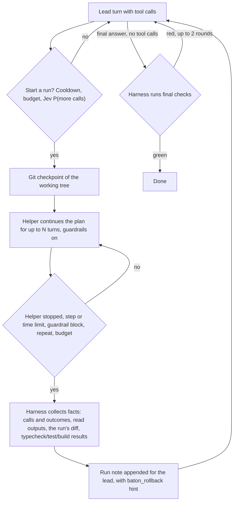

# Baton

Baton is an extension for the [pi](https://github.com/earendil-works/pi-coding-agent) coding agent that runs **speculative execution** inside one session. An expensive lead model (Opus by default) plans, writes and verifies. After a lead turn with tool calls, a cheap helper model (GLM by default) continues the lead's own plan for a few steps in the same session, with the same context. Then the lead takes over again and gets a `[Baton harness]` note that says exactly what happened.

The lead is never misled about authorship: it knows from its system prompt that speculation exists, every run is reported as the helper's work, the report contains facts collected by the harness (not the helper's claims), and every run can be rolled back.

## How a run works



- **Start.** After every lead turn with tool calls, outside the cooldown (1 lead turn after a run) and while the budget allows. With Jev on, Jev must also estimate P(the lead makes more tool calls) ≥ 0.8; it sees the task and the last 4 turns of both models. Without Jev, or when Jev fails, a run starts on any lead turn with tool calls.
- **Run.** The helper gets a short instruction (hidden from the lead): continue the lead's plan, batch independent calls, don't redesign, don't rewrite or delete existing files and tests, stop when the next step needs a decision. It sees the lead's view plus its current run, not older runs.
- **Stop.** The helper stops calling tools, the step limit (6 turns) or time limit (150 s, below the lead's 5-minute cache TTL) is reached, a guardrail blocks a call, the same call returns the same output 3 times, or the budget enters wrap-up. A red test is not a stop: fixing it is part of the plan.
- **Report.** The lead never sees the helper's messages. It gets one note appended at the end of its context (old messages are not rewritten, so its prompt cache stays valid).

### What the lead reads after a run

```text
[Baton harness] Speculative run #3 — performed by the helper model (glm-5.3-flash), not by you.

After your last tool call the harness let the helper continue your work in this session: 4 turn(s), 6 tool call(s). It stopped because the helper stopped calling tools. ...

Checkpoint: the working tree before the run is saved as git tree 4b1c…. To undo this run, call baton_rollback({run: 3}). To inspect it: `git diff 4b1c… 9e02…`.

Tool calls of the helper:
1. read src/model.ts → ok (output below)
2. edit vite.config.ts → ok
3. bash `npm test 2>&1 | tail -3` → UNRELIABLE — exit 0 comes from the last command of a pipe, but the output reports errors: FAIL src/game.test.ts

Files changed by the run (1):
- modified vite.config.ts

Diff of the run (checkpoint → end of run):
...

Checks run by the harness after the run (SOME FAILED):
- test: `npm test --silent` → PASS
- build: `npm run -s build` → FAIL (exit 1)
    error: JSX syntax extension is not enabled

Read outputs (verbatim):
--- read src/model.ts ---
...

Continue the task from here. You are responsible for this work: review the diff, fix what is wrong or roll the run back, and make sure typecheck, tests and the build pass before you finish.
```

- **Outcomes are honest.** A tool error is `ERROR`. A check command that exits 0 while its output reports errors is `UNRELIABLE`: with a pipe, the exit status belongs to the last command (`npm test | tail`).
- **Checks are run by the harness.** After a run that changed files, Baton runs the project's typecheck, tests and production build itself (from `package.json`: the `typecheck` script or `tsc --noEmit`, then `test`, then `build`; override with `checks.commands`).
- **Reads are not lost.** Read-only outputs (`read`, `grep`, `ls`, read-only `bash`) go to the lead verbatim, deduplicated, up to 40 000 characters per note, so the lead does not re-read the files.
- **No helper prose.** The helper's text is not included, so a claim like "all green" never reaches the lead.
- **Full transcript mode.** `BATON_TRANSCRIPT=full` passes every helper output verbatim (up to `noteChars`), for when the lead should judge the whole batch and either keep it or roll it back.

### What the lead is told up front

Baton appends a section to the system prompt: a helper may continue its work between turns; runs are reported as `[Baton harness] Speculative run #N`; that work is the helper's, so review the diff, continue from where it stopped, or call `baton_rollback`; and **the lead owns the final verification** (typecheck, tests, build).

When the lead gives its final answer and files changed since the task started, the harness runs the checks again. If any fails, the lead gets a `[Baton harness] Final checks` note and continues, at most 2 rounds per task.

## Quick start

Requires Node.js 22 or newer and `OPENROUTER_API_KEY` for the default models and Jev.

```sh
bun install
bun run build
export OPENROUTER_API_KEY=...
pi -e ./dist/index.js
# or, after the build: pi install .
```

The npm name `pi-baton` is not published yet. `BATON_SPEC=0` keeps the lead working alone with the same harness checks, which is the baseline for comparing runs.

## Safety

- **Guardrails.** During a run the helper may read, run checks, create files and make targeted edits. These calls are blocked and end the run: overwriting an existing file with `write`, removing or skipping test cases, deleting test files, `--passWithNoTests`, a new `as unknown as` cast, dependency downgrades or pinned installs, git commands that change history or discard work (`commit`, `reset`, `checkout`, `restore`, `stash`, `clean`, …), and `baton_rollback`.
- **Checkpoints.** Before each run, Baton stores the working tree (tracked and untracked files, `.gitignore` respected) as a git tree object built in a temporary index. Your index, `HEAD` and refs are not touched. Outside a git repository there are no checkpoints, and the note says so.
- **Rollback.** `baton_rollback({run})` (lead only) restores every file the run changed to the checkpoint and deletes files the run created. Files changed again after the run are left as they are and listed.
- **Budget.** `BATON_BUDGET_USD` (or `budget.usd`) caps spend for the pi process: provider-reported lead and helper costs (helper × `helperCostFactor`, default 1) plus Jev calls. When what is left only covers the lead's wrap-up (the larger of `reserveUsd` 0.25 and twice the largest lead turn), runs stop and the lead is told to finish and verify. At the budget itself the run is aborted, and later prompts in the process are refused.

## Configuration

User file `~/.pi/agent/baton.json` (or `$PI_CODING_AGENT_DIR/baton.json`), then the project file `.pi/baton.json`, then environment variables. `lead`, `helper`, `budget`, `journalDir`, `jev.model` and `jev.fallbackModel` are ignored in the project file (with a warning): a repository cannot choose your models, spend or file locations. Defaults are `DEFAULT_CONFIG` in [`src/config.ts`](src/config.ts).

| Key | Default | Meaning |
|---|---|---|
| `lead` | `openrouter/anthropic/claude-opus-5.5` | Lead model, `provider/id` in pi's registry |
| `helper` | `openrouter/z-ai/glm-5.3-flash` | Helper model |
| `speculate` | `true` | Speculative runs on or off |
| `steps` | `6` | Helper turns per run |
| `maxRunMs` | `150000` | Wall-clock cap of a run |
| `cooldown` | `1` | Lead turns after a run before the next one |
| `repeatLimit` | `3` | Identical call with identical output this many times ends the run |
| `transcript` | `"facts"` | `"facts"` or `"full"` |
| `readChars`, `diffChars`, `commandTailChars`, `noteChars` | 40000, 16000, 1500, 120000 | Note size budgets |
| `guardrails`, `checkpoints` | `true`, `true` | |
| `checks` | `{ afterRun: true, final: true, maxFinalRounds: 2, timeoutMs: 120000 }` | Harness checks; `commands` overrides detection |
| `jev` | `{ enabled: true, model: "typesafe/jev-1.13", fallbackModel: "microsoft/microsoft-decision-1", timeoutMs: 800, threshold: 0.8, recentTurns: 4 }` | Start decision |
| `budget` | `{ usd: 0, helperCostFactor: 1, reserveUsd: 0.25 }` | `usd` 0 = no budget |
| `journalDir` | `.pi/baton` | Must stay inside the working directory |

On/off variables accept `1`/`on`/`true`/`yes` and `0`/`off`/`false`/`no`.

| Variable | Effect |
|---|---|
| `OPENROUTER_API_KEY` | OpenRouter models and Jev. Never read from config files. |
| `BATON_LEAD`, `BATON_HELPER` | Models |
| `BATON_SPEC` | Speculation on or off |
| `BATON_STEPS` | Helper turns per run |
| `BATON_TRANSCRIPT` | `facts` or `full` |
| `BATON_CHECKS` | Harness checks after runs and at the final answer |
| `BATON_JEV`, `BATON_JEV_MODEL`, `BATON_JEV_FALLBACK_MODEL` | Jev on or off, and its models |
| `BATON_BUDGET_USD` | Process-wide budget |
| `BATON_JOURNAL_DIR` | Journal directory |
| `PI_CODING_AGENT_DIR` | Location of the user config file |

## Journal

Per pi session: `<journalDir>/sessions/<session id>/events.jsonl` (tasks, Jev answers, start decisions, runs, blocked calls, usage, final checks, rollbacks) and `summary.json` (spend, costs per model, run stats, stop reasons, every run with its checkpoint trees). The journal directory gets a `.gitignore` of `*`, which also keeps it out of checkpoints.

## Privacy

The lead and helper providers receive the session as pi sends it. With Jev on, OpenRouter's decisions endpoint (`https://openrouter.ai/api/alpha/decisions`) receives the task text and short summaries of the last turns' tool calls and outputs. `BATON_JEV=0` turns that off.

## Architecture

All files are in `src/`. Everything except `extension.ts`, `git.ts`, `checks.ts` and `journal.ts` is pure.

| File | Role |
|---|---|
| `extension.ts` | pi wiring: model switches, run lifecycle, notes, final checks, budget, `baton_rollback` |
| `run.ts` | Run state, start decision, stop rules |
| `notes.ts` | Every text the models read: lead system note, helper instruction, run note, final checks, budget, rollback |
| `context.ts` | Lead and helper views of the transcript |
| `calls.ts` | Tool-call classification and honest outcomes |
| `guard.ts` | Helper guardrails |
| `decision.ts`, `jev.ts` | Jev state and question; decisions API client |
| `git.ts` | Checkpoints, run diffs, rollback |
| `checks.ts` | Detecting and running typecheck, tests and build |
| `budget.ts` | Spend and budget levels |
| `config.ts`, `journal.ts` | Configuration; journal |

## Development

```sh
bun install
bun run check     # tsc --noEmit and vitest
bun run build     # tsc -p tsconfig.build.json → dist/
bun run smoke     # npm pack, install the tarball, load the extension
```

GitHub Actions runs check, build and smoke on Node.js 22 and 24. The experiment log of earlier versions (advisor mode, phased switch mode, measurements) is in [docs/history.md](docs/history.md).

## License

MIT
