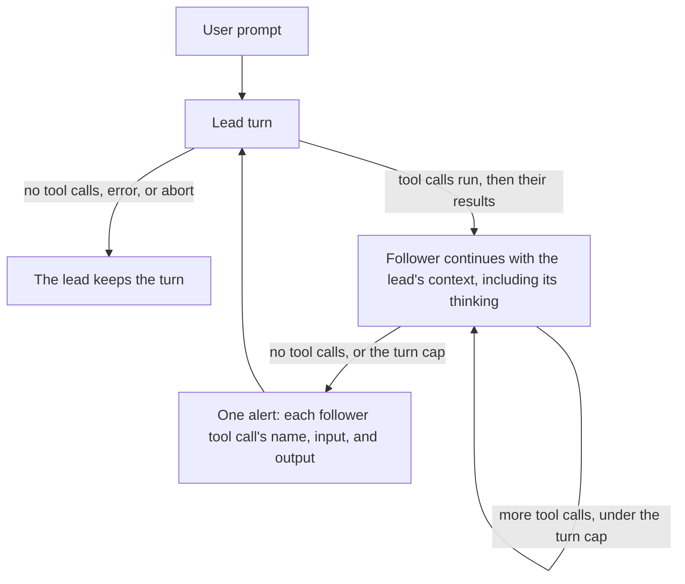

# Baton

Baton is an extension for the [pi](https://github.com/earendil-works/pi-coding-agent) coding agent that runs **speculative execution** inside one session. The lead model (Opus by default) works as the normal model. When its turn contains tool calls, those calls run as usual. Baton then switches to a cheaper follower model (GLM by default) with the full accumulated context, especially the lead's thinking, plus the tool results. The follower continues the task. It is not given a named request, and it uses the normal tools.

Control returns to the lead when the follower produces a turn with no tool calls, or when it hits its turn cap (10 turns, 5 on the first run). The handback is one comment, a speculative automation alert, listing every follower tool call's input and output from that run. That tool log is the complete record, like a diff. The lead does not re-read files just to reconstruct it, and does judge the changes and decide whether to accept them.

This is not the lead calling a subagent.

- The follower receives the lead's whole context, especially its thinking, so it continues the same line of work and should do better than a subagent.
- A subagent either receives a large brief the lead must write (expensive for the lead) or gathers that context again itself (slow, and not necessarily cheap).

With speculation off (`BATON_SPEC=0`), Baton does not inject a section and does not switch the model.

## What the runs showed

Baton tested whether GLM 5.3 Flash can continue work Claude Opus 5.5 already started, in the same pi session, and save money without losing quality. Those runs used an older mechanism (automatic continuation, Helper requests, undo, and a write boundary). The run log is [docs/experiment.md](docs/experiment.md).

- 14 hidden tests: both 14/14. Speculation $0.33 / 6.1 min; Opus $0.62 / 18.4 min.
- 21 tests: Opus 21/21 in 187s for $0.92. Finished Baton runs 20/21, about half the cost, 3–4× slower. One Baton run hit the cap at 18/21.
- 30 tests, dirty tree: finished Baton 29/30 ($0.87, 667s). Opus 30/30 on tests ($1.21, 240s), audit failed on a git leak. The other Baton run aborted on an Anthropic ToS stop before any edit ($0.30, 45s).

Automatic same-session speculation was cheaper, and once the suite grew it was slower and one test short. Opus delegating the key work to a Flash subagent was never measured. These runs are history: the code and the suite changed, and the 30-test pair is not current HEAD. The 18 October r7 bills in that log paid for 1-hour cache writes; the same logged tokens at the 5-minute write price are a counterfactual in the same note, not a second paid run.

## How it works



- **One transcript, two views.** The stored messages stay in order. Each model sees a filter of them. The lead sees the alert where the follower's tool work sits, and does not see the raw follower tool transcripts or the follower's thinking. The alert stays at that position, so later lead turns keep the same prefix. The follower sees the lead's full context, including lead thinking, the real tool calls and results, and user messages. Alerts are left out of its view, including on a later switch back. A user message during the follower run stays as its own message, beside the alert, and is not folded into it.
- **The follower continues the work.** It is not restricted to a sentence the lead wrote. It may read, edit, write, and run commands with the normal tools.
- **Natural stop.** A run ends when the follower stops calling tools, or at a safety cap (10 turns, 5 on the first run). A failed request or an interrupt also returns the lead, so the session is not left on the follower. There is no time limit: while the follower works, Baton keeps the lead's prompt cache warm (see [Lead cache keepalive](#lead-cache-keepalive)).
- **No predictor.** A run starts after every lead turn that contains tool calls, except a turn that errors or is aborted. A useless run costs one cheap request and a short alert.

### What the lead reads after a run

```text
[speculative automation alert] Execution was switched automatically to a weaker, cheaper model to save cost. The tool calls below are the complete record of what it did. Do not re-read the files just to reconstruct that record. Judge the changes strictly and decide whether to accept them. Optimizing model tool calls:
1. read
input: {"path":"src/game/board.ts"}
output: export function clearRows() { ... }
2. bash
input: {"command":"npx vitest run"}
output: Tests: 1 failed
3. edit
input: {"path":"src/game/board.ts","edits":[]}
output: Edited
```

The alert is the lead's view of that work: the name, input, and output of each follower tool call. Follower thinking is omitted. The same inputs and outputs are not also shown as raw tool messages.

### What each model is told

A few sentences, as a system section:

- **Lead.** After a turn that uses tools, a cheaper model may continue the task. A speculative automation alert means that work is already in the transcript. Judge it strictly and decide whether to accept it.
- **Follower.** Continue the work already in the context. Use the normal tools. When that work is done, or the next step needs a decision it cannot make, stop without a tool call.

During a run the follower thinks at `helperThinking` (`low` by default); the lead's level comes back when the lead takes over.

### Lead cache keepalive

Anthropic keeps a prompt cache entry for 5 minutes after the request that last used it. The lead sends nothing during a run, so after a long run its next turn would write its whole prompt to the cache again instead of reading it (a cache write costs 1.25× the input price, a read 0.1× or less). While a run is active, Baton re-sends the lead's last request every `cacheKeepaliveMs` (290 s), counted from the start of that request and then of each re-send:

- **The same request.** The body is the lead's last provider payload, copied when pi sent it. Messages, tools, thinking settings, `max_tokens` and cache markers stay as they were, because a change to any of them misses the cache. It goes through pi's own provider with the same session id, which OpenRouter uses to route to the same upstream cache.
- **Aborted at once.** The re-send is aborted at the first event of the model's reply. By then the provider has read the prompt and renewed the entry, so it costs a cache read and a few output tokens.
- **Only while the lead waits.** It starts with a run, if the lead's last request used the prompt cache, and stops when the run ends, a prompt arrives, the agent ends, or the session changes. A run that ends within 290 s of the lead's request sends nothing.
- **Outside the transcript.** Neither model sees it. Each re-send is a `cache_keepalive` journal event with the usage the provider reported before the abort, and that usage counts in `summary.json`. Anthropic's API reports usage at the start of a reply; OpenAI-compatible endpoints report it only at the end, so their events carry no usage. Pi's own session cost does not include these requests.

290 s leaves 10 s of the 5-minute lifetime for the request to reach the provider. The clock starts when pi hands the lead's request to the provider, slightly before the provider renews the entry. If an event shows `cacheWrite` instead of `cacheRead`, lower `cacheKeepaliveMs`. With `PI_CACHE_RETENTION=long` the entry lives an hour, so runs shorter than that need no keepalive: set `cacheKeepaliveMs` to `0`.

Pi's own `cacheWarming` cannot do this: it refreshes only the current request, which after the switch to the follower is the follower's. Pi's bundled catalog also gives the default OpenRouter Opus no cache lifetime, so pi does not warm it even between follower runs.

## Quick start

Requires Node.js 22 or newer, and `OPENROUTER_API_KEY` for the default models.

```sh
bun install
bun run build
export OPENROUTER_API_KEY=...
pi -e ./dist/index.js
# or, after the build: pi install .
```

The npm name `pi-baton` is not published yet. `BATON_SPEC=0` keeps the lead working alone, which is the baseline for comparing runs.

The 2048 eval scripts `evals/reatom-2048/run-opus.sh`, `evals/reatom-2048/run-opus-subagent.sh`, and `evals/reatom-2048/run-baton.sh` each take a workspace name, prepare it, and start that variant. Harness flags are in [evals/reatom-2048/README.md](evals/reatom-2048/README.md).

## Configuration

User file `~/.pi/agent/baton.json` (or `$PI_CODING_AGENT_DIR/baton.json`), then the project file `.pi/baton.json`, then environment variables. `lead`, `helper` and `journalDir` are ignored in the project file (with a warning): a repository cannot choose your models or file locations.

| Key | Default | Environment | Meaning |
|---|---|---|---|
| `lead` | `openrouter/anthropic/claude-opus-5.5` | `BATON_LEAD` | Lead model, `provider/id` in pi's registry |
| `helper` | `openrouter/z-ai/glm-5.3-flash` | `BATON_HELPER` | Follower model |
| `helperThinking` | `low` | `BATON_HELPER_THINKING` | Follower thinking level during a run: `off`, `minimal`, `low`, `medium`, `high`, `xhigh`, `max`, or `inherit` to keep the lead's level |
| `speculate` | `true` | `BATON_SPEC` | Speculative runs on or off; off when lead and helper are the same model |
| `maxHelperTurns` | `10` | `BATON_MAX_TURNS` | Safety cap of follower turns per run (`5` on the first run) |
| `cacheKeepaliveMs` | `290000` | `BATON_CACHE_KEEPALIVE_MS` | [Lead cache keepalive](#lead-cache-keepalive) interval during a run; `0` = off, otherwise 60000–3600000 |
| `journalDir` | `.pi/baton` | `BATON_JOURNAL_DIR` | Must stay inside the working directory |

On/off variables accept `1`/`on`/`true`/`yes` and `0`/`off`/`false`/`no`.

## Journal

Per pi session: `<journalDir>/sessions/<session id>/events.jsonl` (prompts, run starts and ends, per-request usage including the lead's cache writes, lead cache keepalives) and `summary.json` (costs per model including keepalives, run stats, stop reasons, and every run with its turn and call counts). The journal directory gets a `.gitignore` of `*`.

## Architecture

| File | Role |
|---|---|
| `src/extension.ts` | pi wiring: hand-over, thinking levels, stop rules, the alert, usage |
| `src/run.ts` | Run state and the follower's tool calls |
| `src/notes.ts` | The two system sections and the alert |
| `src/context.ts` | Lead and follower views of the one transcript |
| `src/keepalive.ts` | Lead cache keepalive: re-sends the lead's last request during a run |
| `src/config.ts` | Configuration |
| `src/journal.ts` | Journal |

## Development

```sh
bun install
bun run check     # tsc --noEmit and vitest
bun run build     # tsc -p tsconfig.build.json → dist/
bun run smoke     # npm pack, install the tarball, load the extension
```

GitHub Actions runs check, build and smoke on Node.js 22 and 24. The experiment log of earlier versions is in [docs/history.md](docs/history.md).

## License

MIT
