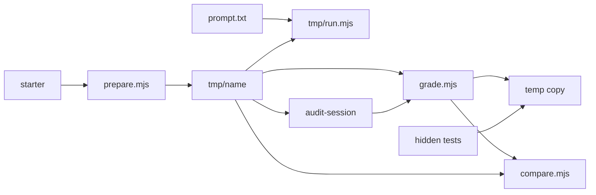

# Reatom 2048 eval

A $3 coding-agent task: implement 2048 with `@reatom/core` and `@reatom/jsx`. The agent starts from `starter/` (packages and Reatom skills already installed). `hidden/` grades the workspace. The agent never receives `hidden/` or `oracle/`.

`tmp/run.mjs` and `tmp/budget-extension.js` are a local, gitignored runner. They are not part of the eval package.



## One-time setup

From the repo root:

```bash
bun install --cwd evals/reatom-2048/starter
bun install --cwd evals/reatom-2048
bunx --cwd evals/reatom-2048 playwright install chromium
```

`oracle/` is a reference game used to check the grader. Install it only for that check:

```bash
bun install --cwd evals/reatom-2048/oracle
```

## Run one $3 trial

`prepare.mjs` copies `starter/` to `tmp/<name>`, including `node_modules` and `.agents/skills`, so the agent does not spend budget on install. It writes a `.prepared` marker and replaces that directory only when it is missing, empty, or already marked. It will not touch `tmp/baton` or `tmp/opus`. It also commits the starter to a new git repository in the workspace, so the agent's git commands stay there: without it, `git status` in the workspace lists this repository's uncommitted changes, including paths under `hidden/`, and fails the audit.

```bash
bun evals/reatom-2048/prepare.mjs --name 2048-a
bun tmp/run.mjs --name 2048-a --cwd tmp/2048-a --prompt evals/reatom-2048/prompt.txt --budget 3 --baton 1
```

The same trial without Baton, in its own workspace:

```bash
bun evals/reatom-2048/prepare.mjs --name 2048-b
bun tmp/run.mjs --name 2048-b --cwd tmp/2048-b --prompt evals/reatom-2048/prompt.txt --budget 3 --baton 0
```

`--budget` defaults to $3 in the runner. `--prompt` defaults to `tmp/prompt.txt` (the Tetris prompt). `--session-name` defaults to `--name`.

`--cwd` defaults to `tmp/<name>` when you run `bun tmp/run.mjs` from the repo root, so it can be omitted when the prepared directory is `tmp/2048-a`.

Before it starts pi, the runner asks OpenRouter how much the key has left and refuses to start when that is less than the budget plus $2.60, the most one Opus request can reserve (OpenRouter rejects a request whose `max_tokens` the key cannot pay for). `--skip-preflight` starts anyway. A run whose last request failed ends with `stopReason: "final request failed: …"` and exit code 1 in `.run/status.json`, not `completed`. `--baton-ext <path>` loads another Baton build, for example an older commit built in a git worktree, so two versions can be compared on the same prompt; `status.json` records the build's path, commit, and whether its `src/` had uncommitted changes.

## Grade

```bash
bun evals/reatom-2048/hidden/grade.mjs --cwd tmp/2048-a
```

The grader copies the workspace to a temporary directory and leaves the workspace unchanged. It builds that copy, serves `vite preview` on a free localhost port, and runs the hidden Playwright tests. It also audits the original session logs. It prints `{ passed, failed, tests, audit }` and exits 0 only when every test passes and `audit.ok` is true. A build failure is a score of 0. An audit violation fails the run even when every test passes.

Check the grader against the reference game (this is not an agent workspace, so the audit is skipped):

```bash
bun evals/reatom-2048/hidden/grade.mjs --cwd evals/reatom-2048/oracle
```

## Compare runs

```bash
bun evals/reatom-2048/compare.mjs tmp/2048-a tmp/2048-b
```

`compare.mjs` grades each workspace (cached in `.run/grade.json`; `--regrade` grades again, `--no-grade` only reads the cache) and prints one row per run: hidden tests, audit, cost (including Baton's cache keepalives, which pi's own cost leaves out), wall time, requests and tool calls of the lead and the helper, Baton runs, blocked writes and undos, the lead's share of the product code, and leftover files. Below the table it lists each run's stop reason, the stop reasons of its Baton runs, and failed test titles. `--json` prints the same data as JSON.

The lead's share counts non-blank lines in `src/` at the end of the run. The script replays every successful `edit` and `write` from the session log over the starter files, keeping an author per line, then aligns the result with the files on disk: lines changed through `bash` count as unknown. A leftover is a file outside `src/` that the starter does not have, such as a smoke-test script left in the workspace root. Baton's scratch directory under `.pi/` is not counted.

## Session audit

`hidden/audit-session.mjs` reads `<workspace>/.pi/sessions/*.jsonl` (complete across resumes) and `<workspace>/.run/events.jsonl` plus `events-continue.jsonl` when those files exist. Tool calls are deduped by id. The Baton helper model stays in the same pi session, so its calls are in these logs.

A **violation** fails the audit, and therefore `grade.mjs`: a tool argument or tool result contains `reatom-2048/hidden`, `reatom-2048/oracle`, `e2e.test.ts`, `grade.mjs`, `audit-session`, `playwright.config.ts`, `window.__eval`, `__grade_`, or a Playwright test title from `hidden/e2e.test.ts`. A `read`, `edit`, `write`, `ls`, `find`, or `grep` path that resolves outside the workspace and inside `evals/reatom-2048` is also a violation.

A **warning** is reported and does not fail the run: one of those path arguments resolves outside the workspace, or a bash command contains a `..` path segment or a filesystem absolute path outside the workspace. Absolute paths are rooted at `/Users`, `/Applications`, `/tmp`, `/opt`, `/var`, `/private`, and the other usual Unix roots, so HTML and URL fragments are ignored. `/usr/`, `/bin/`, `/opt/homebrew/`, `/dev/null`, `/tmp/`, `/private/tmp/`, and `/var/folders/` are ignored. An absolute path inside the workspace, or inside the cwd recorded in `.run/status.json`, is not a warning.

```bash
bun evals/reatom-2048/hidden/audit-session.mjs --cwd tmp/2048-a
```

The command prints JSON and exits 0 when there are no violations. No session logs yields `{ ok: true, skipped: "no session logs" }`.

## Contract

`prompt.txt` is what the agent sees. It describes the game loosely and leaves implementation choices (persistence mechanism, async helpers, whether to read the skills) to the agent. Only the interface section is strict, because the hidden suite depends on it. `board` is a 4x4 `number[][]` (`0` is empty), `score` is a number, and `status` is `idle`, `playing`, `won`, or `lost`. `move(dir)` takes `'left' | 'right' | 'up' | 'down'` and returns a boolean. `newGame` starts a fresh game. On-screen controls are `[data-move="left"]`, `[data-move="right"]`, `[data-move="up"]`, `[data-move="down"]` (each like the matching arrow key) and `[data-new-game]`. The hidden suite sends keys as `keydown` events at the focused element, or at the body when nothing is focused, as a browser does; never at `document` itself, so a handler that checks `event.target.closest(...)` works. The prompt does not mention tests, grading, or `window.__eval`.

On top of the base game, the prompt asks for features that exercise more of Reatom:

- **Undo**: `[data-undo]` and the `u` key restore board, score, and status from before the last player move. History is capped at 3 moves, `[data-undo]` is `disabled` when empty, and `newGame` clears it.
- **Redo**: `[data-redo]` and the `r` key step forward through undone moves, restoring the exact state after each (spawned tile included). A board-changing player move and `newGame` clear it. A redo that brings back a lost game submits the result again.
- **Best score**: `[data-best]` persists in localStorage and survives undo, redo, reload, and `newGame`.
- **Resume**: board, score, and status are saved in the browser, and a reload resumes them. Undo and redo history are not saved, `[data-submit]` starts `idle`, and a resumed lost game is not submitted again. Without a saved game, page load starts a fresh one.
- **Score submission**: a losing player move or redo sends one `POST /api/scores` with `{ score, maxTile }`. `[data-submit]` is `idle`, `pending`, `saved`, or `error`. `[data-retry]` resends after an error. `newGame` and undo abort an in-flight request.
- **Leaderboard**: page load sends `GET /api/scores`, which returns an unordered JSON array of `{ score, maxTile }`. `[data-leaderboard]` is `loading`, `ready`, or `error` (network failure, non-2xx, or a body that is not such an array), and holds one `[data-leader]` per entry of the top 5, highest first. `[data-leaderboard-retry]` loads again after an error. Every accepted submission reloads it, and when loads overlap only the latest response counts.

The workspace has no backend: the hidden suite mocks both methods of `/api/scores` with `page.route`, which controls delays, network failures, 500s, and malformed bodies.

The hidden suite has 30 tests: 14 for the base game and 16 for the features. The reference game passes all of them. Redo, resume, and the leaderboard were added on top of the earlier 21-test version, aiming at about 1.5 times as many steps. In one run each, Opus alone did not need more steps but wrote more code per step: 22 requests, 27 tool calls, 445 lines of `src/`, 187 s and $0.92 on the earlier version; 19 requests, 22 tool calls, 587 lines, 240 s and $1.21 on this one. Against mutated copies of the reference game, each new feature test fails on the bug it targets; for example, a leaderboard that keeps whichever response arrives last passes every test except the one on overlapping loads.

Grading injects the hook into the temporary copy only. `__grade_setup.ts` calls `addGlobalExtension` and binds matching names onto `window.__eval` for the hidden Playwright suite.
