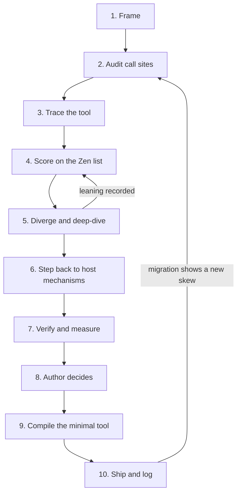

# Reatom API design

Use this skill before adding a helper and again after its first migration. Run the tool in your head against real call sites, find where it fights the host platform or the Zen list, and replace it with the smallest tool that lets users write native code.

Most examples follow a hypothetical global `hotkeys` registry from audit to replacement. The rest use real Reatom APIs. For API facts load the `reatom` skill, plus `reatom-jsx` or `reatom-async` for those packages. To review the finished code, use `reatom-review`.

## Zen rubric

Reatom builds its public API by six rules (handbook, History page):

- **Primitives outperform frameworks**
- **Composition beats configuration**
- **Explicit specifics, implicit generics**
- **Compatibility worth complexity**
- **Easy to use, hard to misuse**
- **Hardest solved, rest resolved**

Score a tool by asking each rule as a question and citing evidence:

| Rule                                  | Ask                                                                     | Fails when                                                                           |
| ------------------------------------- | ----------------------------------------------------------------------- | ------------------------------------------------------------------------------------ |
| Primitives outperform frameworks      | Does a library or platform primitive already do this?                   | The tool owns lifecycle, wraps user code, or rebuilds a host mechanism               |
| Composition beats configuration       | Does it compose with existing APIs as they are?                         | Call sites need a combiner (`mergeRefs`, `composeHandlers`) or a growing options bag |
| Explicit specifics, implicit generics | Is what differs per call site written plainly, and what repeats hidden? | The specific part goes into a config call while the plumbing repeats at every site   |
| Compatibility worth complexity        | Does native code from DevTools, docs, or another codebase drop in?      | Users translate native code into the helper's dialect                                |
| Easy to use, hard to misuse           | What happens on a forgotten step or a misspelled name?                  | Silence: a dead handler, a fallback value, no warning                                |
| Hardest solved, rest resolved         | Who solves the hard part, the library or each user?                     | Lifecycle, cancellation, or context is left to userland                              |

The most common failure inverts the third rule: the specific part (the key, the delay, the condition) disappears into a config call, and the generic part (cleanup, context, cancellation) is copied to every call site.

## Workflow

Copy this checklist and track it:

```
API design:
- [ ] 1. Frame: author constraints ranked, call sites split by kind
- [ ] 2. Audit: real call sites counted per API member
- [ ] 3. Trace: the current tool debugged mentally
- [ ] 4. Score: rubric findings with evidence
- [ ] 5. Diverge: three or more directions, call site first, the leader deep-dived
- [ ] 6. Step back: host mechanisms for the same data flow listed
- [ ] 7. Verify: claims checked through the real code path, costs measured
- [ ] 8. Decide: the author rules where a constraint is ambiguous
- [ ] 9. Compile: the minimal tool built to the rules below
- [ ] 10. Ship: losers deleted, call sites migrated, app verified, log updated
```



The brainstorm is the loop between steps 4 and 5. Each round ends with a **Leaning** in the design log, and a later round marks it superseded. Do step 6 at least once per design, and immediately when every direction rebuilds the same mechanism or the leader keeps collecting open decisions.

## Frame and audit

Frame:

- Copy the author's constraints verbatim and rank them. They break ties later.
- Split call sites by the job they do and route each kind to the mechanism built for it before designing anything. Of 14 `hotkeys.register` calls, 5 close dialogs on Escape and 2 submit forms on Enter. A modal `<dialog>` already closes on Escape, and a `<form>` with a submit button already submits on Enter in a text field, so only the 7 global shortcuts stay in scope. In core Reatom, derived state goes to `computed`, queries to `computed` + `withAsyncData`, commands to `action` + `withAsync`, and external push to `reatomObservable` or `onEvent`. A call site of another kind leaves the tool's scope instead of shaping its API.
- Decide where the fix lives: app code, a library helper, or the library runtime. A local fix that leaves the next user with the same problem is a rejected option, not a shortcut.

Audit usage per API member, not per helper:

```bash
rg --only-matching --no-filename --no-line-number '\bhotkeys\.\w+' src | sort | uniq -c | sort -rn
```

- The skew is the finding. `register` 14, `unregister` 3, `scope` 0: the designed scoping feature is unused, and 11 registrations are never removed.
- Record the shapes the tool forces (a `wrap` around every handler, a growing options bag) and the leftovers it cannot remove.
- Treat the first implementation as a probe: migrate the real call sites, then audit. A design made before the audit optimizes the path users do not take. When a subagent designs the tool, hand it the audit table and the rubric, not only the goal.

## Mentally debug the tool

Step through one real call site the way a debugger would, from the call to what the host executes. Fill in one sheet per tool:

```markdown
- Tool: name and signature
- Call site: one real call site, copied
- Emits: the exact output, expanded until the host sees it
- Lifecycle: creation → connect → update → scope change → disconnect; what starts it (call, first subscriber, mount) and what cleans up
- Reatom frame: which frame runs it, what aborts it, which context or document owns its state
- Cost: observers, subscriptions, listeners, or rules per site × audited site count
- Forgotten step: error, DEBUG warning, or silence
- Misspelled name or value: type error, runtime error, or silence
- No provider or no subscriber: what renders or runs
- Defined twice: same definition (HMR, duplicated package), conflicting definition
- Elsewhere: second context, second document, server, tests in Node, older engines and build targets
- Copy-paste: does native code from DevTools or docs drop in
- Reads like: does the call site read like its output
```

The registry's sheet, abridged:

- Emits: one shared `keydown` listener on `window`, plus one map entry per `register`.
- Lifecycle: entries live until `unregister`; the listener lives forever.
- Reatom frame: handlers run inside the listener, outside any frame, unless each call site wraps them.
- Forgotten step: without `unregister`, the handler keeps firing after its screen closes. Silence.
- Misspelled combo: `'mod+kk'` never matches. Silence.
- Defined twice: HMR re-runs the module and registers the combo again, so the handler fires twice.
- Elsewhere: a popup window gets no listener; tests share the module-level map.

Rules for the sheet:

- Expand all the way to what the host runs. Lifecycle, ordering, and context bugs exist only there.
- For a core extension or factory, the lifecycle line covers `.extend` order and key collisions, which hooks fire (connect, change, call), whether the unit is lazy (`computed`) or eager (`effect`), and what aborts its async work.
- Every "silence" is a finding against "easy to use, hard to misuse".
- Mark each line checked or assumed. Only checked lines support conclusions.

Then score the tool on the rubric. For each failed rule, write one paragraph with evidence from the audit or the sheet. A failure without a call site or a sheet line is an opinion: find the evidence or drop it. For the registry: lifecycle and context are left to call sites ("hardest solved"), two failures are silent ("hard to misuse"), and every call site repeats `wrap` and `unregister` ("explicit specifics, implicit generics").

## Find a better tool

Diverge:

- Write at least three directions. Include one that adds nothing (does the problem exist at this scope?), one that fixes ownership in app code instead of the API, and one that reuses a mechanism the library already has.
- Write each direction in this order: the call site users write, its exact desugaring, a runtime sketch over existing code paths, costs, and the rubric score.
- Deep-dive the leader: semantics (source, timing, reactivity, precedence, absence, `null`), the runtime sketch, the misuse story, and the open decisions (scope changes, writers outside the tool, cost, explicit or implicit).
- Prefer a structural guarantee to a warning. `onEvent` inside an abort scope has no `unregister` to forget: the scope that added the listener removes it.
- Start explicit. Make it implicit later if the audit or a DEBUG warning shows the explicit form is pure boilerplate.
- Treat author proposals as candidates. Desugar each into an existing direction, list costs with concrete counterexamples, and look for an improved form. Sugar is allowed only as an exact desugaring of a primitive.
- Keep every rejected option with a one-line reason, so it does not come back under a new name.

Step back by asking what all directions have in common. Every hotkey direction (an `unregister` per call site, a registry keyed by component, a wrapper component) rebuilt listener lifecycle, and the library already had it: `onEvent` drops its listener when its abort scope ends. The host mechanisms for keyboard input:

| Mechanism                       | Fit                                                            |
| ------------------------------- | -------------------------------------------------------------- |
| Modal `<dialog>`                | Escape closes it and fires `close`                             |
| `<form>` implicit submission    | Enter in a text field submits                                  |
| `accesskey`                     | Per element, with a browser-defined modifier; hard to discover |
| `onEvent(window, 'keydown', …)` | Global shortcuts with abort-scoped cleanup and Reatom context  |

1. Name the direction the data flows: within one unit, parent to children, children to parent, or external source to state. Keyboard shortcuts flow from an external source to state.
2. Table every host mechanism for that direction with its fit, as above: platform and language features, plus the library's own props, hooks, extensions, and internal walks. In core Reatom that includes `withConnectHook` for lazy lifecycle, `variable` for values scoped to a call tree, `abortVar` for cancellation, and `.extend` for grouping.
3. Ask whether the problem exists without the edge case. Debouncing a filter over 200 local items is unnecessary, because filtering them in a `computed` is cheap. Only the remote search needs a delay, and that is `await wrap(sleep(300))` inside its async computed.
4. Compare a JavaScript reimplementation with the host mechanism on timing windows, SSR and first paint, scope changes, per-instance work, and deleted code. Name the argument that decides.
5. Measure performance before arguing it. "One shared listener beats one per feature" needs a profile at real sizes; when the difference is invisible, drop it as an argument.

Search ladder, cheapest first. Stop at the first rung that holds:

1. **Nothing.** The real scope does not need a tool.
2. **Ownership.** Move the code to the module that owns the state or markup.
3. **Host mechanism.** The platform or language already does it.
4. **Existing library feature.** A prop, hook, extension, or internal walk already does it.
5. **Thin helper.** Names, conditions, and types over rung 3 or 4.
6. **New runtime feature.** Only with full semantics, a misuse story, and the open decisions written out.

The hotkey registry sat at rung 6: a runtime with its own lifecycle. After the step back, the Escape and Enter call sites dropped to rung 3, lifecycle and context went to rung 4 (`onEvent` inside a connect hook), and the only new code is a rung 5 factory, `reatomHotkey()`, that turns a key combo into a Reatom action. Consumers use `take`, `getCalls`, and hooks they already know.

## Verify and decide

- Check the tool through the code path the library uses: dispatch real events at `window` and let the connect hook deliver them. Consumers of the tool can then be tested by calling the action directly.
- Record the environment of each check, a dated support matrix for platform features, what unsupported environments do, and each gotcha with its consequence and workaround.
- For benchmarks, record the size, the number of runs, the statistic, and the engine.
- Check that each type test fails on the mistake it claims to catch. Put `@ts-expect-error` on `reatomHotkey('mod+kk')`, so the test breaks if the type ever accepts the typo.

When the choice turns on how to read a constraint, present the evidence and both readings and let the author rule. Do not reinterpret a constraint silently. Under a "no global listeners" rule, is one `onEvent(window, 'keydown', …)` per feature, removed on disconnect, a global listener? Both readings are defensible, so the author decides.

## Compile the tool

1. **Produce a primitive, not a protocol.** The best output is a unit the library already knows how to consume: an atom, an action, a computed. Then every general method works on it (`take`, `effect`, `getCalls`, `withCallHook`, `ifChanged`, logs, tests), and the tool needs no `register` / `subscribe` / callback API of its own. `reatomHotkey('mod+k')` is an action, so waiting for a shortcut is `await wrap(take(paletteHotkey))`, and nothing about hotkeys has to be learned on the consumer side.
2. **Emit values, don't wrap code.** When the product is a plain value (a URL, a name, a props object), return it for native code instead of taking the user's code as an argument. `route.path(params)` returns a string for a native `href`: middle-click, copy link, and keyboard navigation keep working, and `urlAtom` still intercepts the click for SPA navigation.
3. **One declaration feeds both sides.** `reatomRoute('users/:userId')` builds URLs with `.path({ userId })` and parses them with `route()`, so renaming the param is a type error on both sides. `reatomHotkey('mod+k')` feeds both the event and the menu label, so the hint cannot drift from the binding.
4. **Name methods after what they return or do.** `route.path()` returns a path and `route.go()` navigates. Reject names that hide which one happens (`route.to()`), read as a boolean but return something else, or take a name the platform may claim later.
5. **Validate at definition time.** `reatomHotkey('mod+kk')` throws when it is defined, naming the combo, so tests fail too, instead of shipping a shortcut that never fires.
6. **Guard global registries.** Namespace the keys. Share the registry across package copies (for example under a namespaced key on `globalThis`), because package managers do not always dedupe Reatom packages. Accept the same definition twice (HMR re-runs modules) and throw on a conflicting one, naming both definitions.
7. **Prefer the declarative form when it deletes code.** `AbortSignal.timeout(5000)` replaces a timer, an `abort()` call, and the `clearTimeout` in cleanup. `onEvent` inside an abort scope replaces `addEventListener`, `removeEventListener`, and a `dispose()` method.
8. **Scope state like the resource it tracks.** A module-level `Map` cache is shared by every `context.start()`, so SSR requests and test cases see each other's entries. An atom holding the map is per context. Test with two contexts.
9. **Add sugar on demand, as an exact desugaring.** `withDisconnectHook(cb)` is exactly `withConnectHook(() => () => cb())`. Add sugar only when real call sites repeat the long form.
10. **Stay deletable.** A helper that fills a platform gap should mirror the platform signature, so the native call can replace it by a rename: a `withResolvers()` helper returns `{ promise, resolve, reject }`, like `Promise.withResolvers()`.
11. **Follow Reatom naming.** Use `reatom*` when the product is a model of atoms and actions (`reatomClassName` returns a computed, `reatomHotkey` an action), `with*` for extensions, and a plain name when the product is a value (`css` returns a string). Group related methods on the returned object, as `reatomBoolean` and `reatomRoute` do, instead of exporting siblings.

Bad: the key is the only specific part, yet every call site repeats `wrap`, cleanup, and options.

```ts
hotkeys.register(
  'mod+k',
  wrap(() => paletteOpen.setTrue()),
)
hotkeys.register(
  'mod+shift+p',
  wrap(() => paletteOpen.setTrue()),
  { preventDefault: true },
)
```

Good: the combo is the only specific thing at the call site. The shortcut is an ordinary action, so the consumer waits for it with generic sampling, and the loop stops when `paletteOpen` disconnects.

```ts
const paletteHotkey = reatomHotkey('mod+k')

export const paletteOpen = reatomBoolean(false, 'paletteOpen').extend(
  withConnectHook(async (target) => {
    while (true) {
      await wrap(take(paletteHotkey))
      target.setTrue()
    }
  }),
)
```

The factory hides the plumbing behind the same primitives. The keyboard listener lives only while someone is subscribed to or taking the action:

```ts
export const reatomHotkey = (combo: string, name = `hotkey#${combo}`) => {
  const matchesCombo = parseHotkey(combo)

  return action((event: KeyboardEvent) => {
    event.preventDefault()
    return event
  }, name).extend(
    withConnectHook((target) => {
      onEvent(window, 'keydown', (event) => {
        if (matchesCombo(event)) target(event)
      })
    }),
    () => ({ label: formatHotkey(combo) }),
  )
}
```

The listener calls the action synchronously, so `event.preventDefault()` inside the action runs while the event is still being dispatched. Because the tool is an action, a different consumer can read it in a different way: `getCalls(paletteHotkey)` inside a computed, `withCallHook` for analytics, or a consumer test that calls `paletteHotkey(event)` directly.

## Ship

- Delete the superseded tool completely if it was never published: source, tests, exports, docs, and skill references. If it was published, deprecate it with a mechanical migration.
- Migrate every call site, then rerun the audit query. `hotkeys.` should count zero.
- Verify the affected screens in the running app, not only in unit tests.
- Log bugs found along the way. Fix them only when they are in scope.
- Update the canonical docs in `skills/<skill>/REFERENCE.md` and the skill's implementation defaults.

## Smells

| Signal                                                                  | Usually means                                            |
| ----------------------------------------------------------------------- | -------------------------------------------------------- |
| The designed entry point is unused and an escape hatch carries the load | The tool solves a different problem than designed        |
| A combiner appears (`mergeRefs`, `composeHandlers`)                     | The tool does not compose with the existing API          |
| User code goes in as nested string or callback arguments                | Specifics wrapped, generics repeated                     |
| Every call site repeats the same plumbing (`wrap`, cleanup)             | The tool skipped the hard part                           |
| The tool has its own `register` / `subscribe` / `on` API                | It should be an atom or action, so general methods apply |
| One listener, observer, or subscription per call site for shared state  | A host mechanism is being rebuilt                        |
| A forgotten step or misspelled value fails silently                     | Needs types, a DEBUG check, or a structural guarantee    |
| Native code must be translated into the helper's dialect                | Compatibility is lost                                    |
| A module configures behavior for state it does not own                  | Ownership problem                                        |
| Workarounds remain that the tool cannot remove                          | The real problem is elsewhere                            |
| `let done = false` in a closure, or a module-level cache                | Breaks with a second context, document, or package copy  |
| A rejected option returns under a new name                              | The log lacks rejection reasons                          |

## Design log

Keep the brainstorm next to the code it changes, for example `packages/<package>/logs/<topic>.md`. The trail of rejected options is the point: it stops later rounds from re-proposing them and shows reviewers why the winner won.

```markdown
# <Topic>

<Where it started (link the chat or issue). What is implemented right now; update this every round.>

## Problem

<Real call sites, counts, what the current tool emits.>

## Constraints

1. <Author rule, verbatim, highest priority first>

## Current tool

<API, desugaring, usage table, leftovers it cannot fix, alternatives rejected while designing it.>

## Why it fails

<One paragraph per failed Zen rule, with evidence.>

## Directions

### 1. <Name>

<Call site, desugaring, runtime sketch, costs.>

**Leaning:** <choice and reason>

## <Leader> in detail

### Semantics

### Runtime sketch

### Misuse

### Open decisions

## Step back

<Host mechanisms table, cost comparison, measurements, verified behavior, gotchas.>

## Decision

## Implementation

<What changed while implementing, and which test caught it.>

## Status

- Shipped:
- Removed:
- Migrated and verified in:
- Open bugs:
- Follow-ups:
```

- Write plain declarative sentences with concrete counts and outputs.
- Every behavioral claim names how it was checked (engine and version, test name) or says it is assumed.
- Date every support claim.
- Draw diagrams in Mermaid.
- Mark a superseded round in place ("Superseded by the next section.") instead of deleting it.
